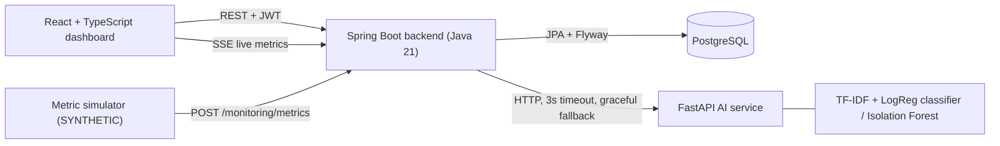

# Architecture

Four deployable parts plus a PostgreSQL database. The backend is the only component that talks to the database.

## Key design decisions

- **Feature-based packages** in the backend (`ticket`, `incident`, `asset`, `monitoring`, `analytics`, `notification`, `audit`, `security`, `ai`, `user`, `common`, `config`), each with entity, repository, service, controller and DTOs.
- **Flyway owns the schema.** Migrations live once in `database/migrations`; Maven copies them into the jar. Hibernate is set to `ddl-auto: none`, so nothing else can change the schema.
- **The AI service is optional at runtime.** `AiClient` uses a 3-second timeout and returns an empty result on failure. Tickets fall back to category `other`. Monitoring falls back to threshold rules. Nothing crashes if Python is down.
- **No DB transaction is held during the AI call.** `MonitoringService.ingest` calls the AI first, then persists the metric, anomaly event and incident in one short transaction.
- **Duplicate-alert protection in two layers.** The service reuses an active monitoring incident for the same asset, and a partial unique index (`uq_incident_active_monitoring`) enforces it in the database.
- **Stateless JWT security.** BCrypt password hashes, role checks with `@PreAuthorize`, employees restricted to their own tickets, and audit logs readable only by admins and managers.
- **Analytics are SQL.** `AnalyticsService` runs queries on live tables; no dashboard figure is hard-coded.
- **Real-time updates use Server-Sent Events** (`/api/v1/monitoring/stream`), fanned out by `SseHub`.

## Request flow: metric to incident

1. Simulator posts a reading (`simulated: true`) to `POST /api/v1/monitoring/metrics`.
2. Backend asks the AI service whether the reading is anomalous (may be unavailable).
3. In one transaction: save the metric, apply threshold rules, save an `anomaly_events` row, and open an incident only if the asset has no active monitoring incident. Admins, managers and agents get a notification.
4. Backend pushes `metric` and `incident` events to every connected dashboard.
