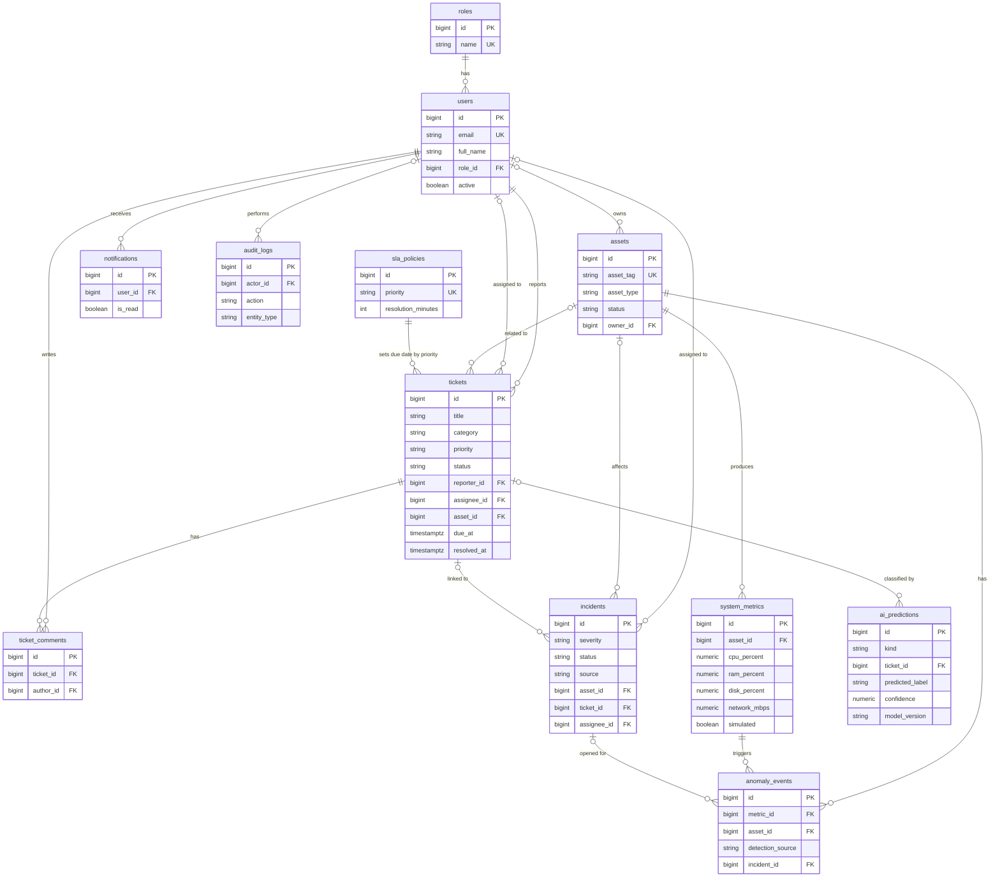

# Database

PostgreSQL 16, 12 tables, managed by Flyway (`database/migrations/V1__core_schema.sql`, `V2__reference_data.sql`). All timestamps are UTC (`TIMESTAMPTZ`).

## Integrity rules

- Primary keys on every table; foreign keys for all relationships (`ON DELETE CASCADE` for comments and metrics, `SET NULL` for optional links such as assignee).
- `CHECK` constraints on roles, priorities, statuses, severities, asset types, metric ranges (0 to 100 %) and `resolved_at >= created_at`.
- Unique: `users.email`, `assets.asset_tag`, `roles.name`, `sla_policies.priority`.
- Indexes on status, assignee, reporter, created date, category, `(asset_id, recorded_at DESC)` and audit timestamps.
- Partial unique index `uq_incident_active_monitoring`: one active monitoring incident per asset.

## Reporting queries

See `database/reports/reports.sql` (tickets by status, priority and category; average resolution time; SLA compliance; agent workload; daily and monthly trends; incident severity; asset health; AI prediction statistics). The same queries run in `AnalyticsService`.

## Seed data

`V2` inserts roles and SLA policies only. Demo users, assets, 40 tickets and metric history are generated by `DemoDataSeeder` when `SEED_DEMO=true`; all of it is synthetic and labelled as such. Passwords are hashed with BCrypt from `DEMO_PASSWORD`, never stored in SQL.

## Validation status

`python database/validate_sqlite.py` translates the migrations to SQLite and checks that the tables, CHECK constraints, foreign keys and the dedupe index behave correctly. **It does not prove PostgreSQL compatibility.** The migrations have not been run on a real PostgreSQL server yet.
